# Forensics Atlas

**The field guide to digital forensics tooling.** A visual, searchable atlas of 274 curated digital forensics and
incident response (DFIR) tools, libraries, labs, CTFs and learning resources in 34 categories, organised by
investigation phase so learners know where to start and professionals find the right tool fast.

**Live site: https://forensics.sajinshivdas.online**

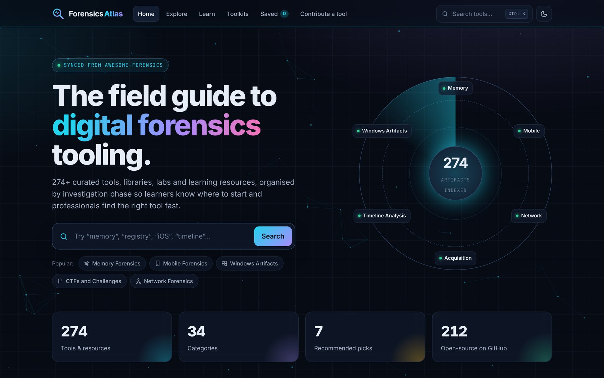

This repository is the public guide to the website: what it offers, how to use every page and option, and where
the content comes from. The site's source code is not published here.

---

## Contents

- [At a glance](#at-a-glance)
- [Home](#home)
- [Explore the atlas](#explore-the-atlas)
- [Tool details](#tool-details)
- [Search everything (command palette)](#search-everything-command-palette)
- [Learning path](#learning-path)
- [Scenario toolkits](#scenario-toolkits)
- [Saved shortlist](#saved-shortlist)
- [Contribute a tool](#contribute-a-tool)
- [Themes](#themes)
- [Phone and tablet](#phone-and-tablet)
- [Footer](#footer)
- [Categories](#categories)
- [Shareable links](#shareable-links)
- [Keyboard shortcuts](#keyboard-shortcuts)
- [Accessibility and privacy](#accessibility-and-privacy)
- [FAQ](#faq)
- [License](#license)

---

## At a glance

| | |
| --- | --- |
| **Entries** | 274 tools, libraries and resources (212 open source, 7 recommended picks) |
| **Categories** | 34, grouped into Tools, Learn, Resources and Develop |
| **Investigation lifecycle** | Prepare → Identify → Acquire → Preserve → Examine → Analyze → Report |
| **Pages** | Home, Explore, Learn, Toolkits, Saved, plus the Contribute a tool pop-up |
| **Filters** | Category, maintenance status, experience level, free-text search, sort |
| **Themes** | 7 colour themes with a light/dark toggle |
| **Works on** | Desktop, tablet and phone; keyboard friendly; no sign-up, no tracking cookies |

## Home

The home page is the starting point:

- **Hero search**: type a term (for example *memory*, *registry*, *iOS*) and jump straight to matching tools.
- **Popular shortcuts** to the most-used categories: Memory Forensics, Mobile Forensics, Windows Artifacts,
  CTFs and Challenges, Network Forensics.
- **Live counters**: entries, categories, recommended picks and open-source projects.
- **Two ways in**: *I'm learning* (a guided path) and *I'm a practitioner* (task-based toolkits).

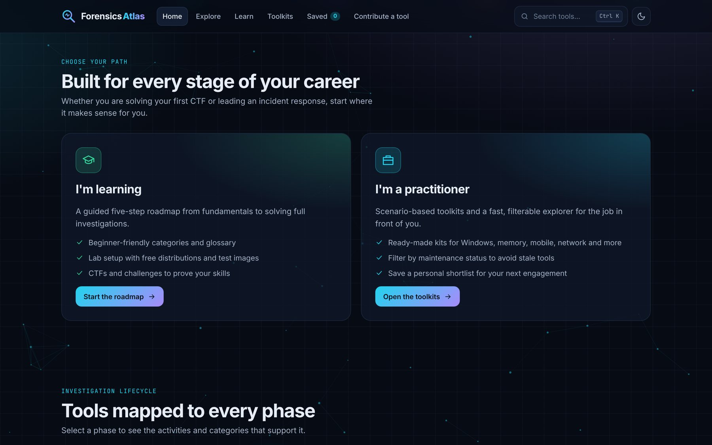

- **Investigation lifecycle**: every category is mapped to a phase of an investigation. Pick a phase to see the
  categories and tools that belong to it.

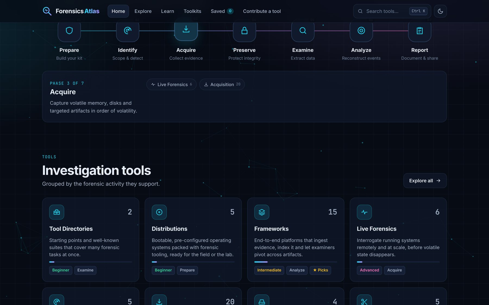

## Explore the atlas

`#/explore` lists every entry. The sidebar holds the categories (with entry counts); the main area shows the
results as cards.

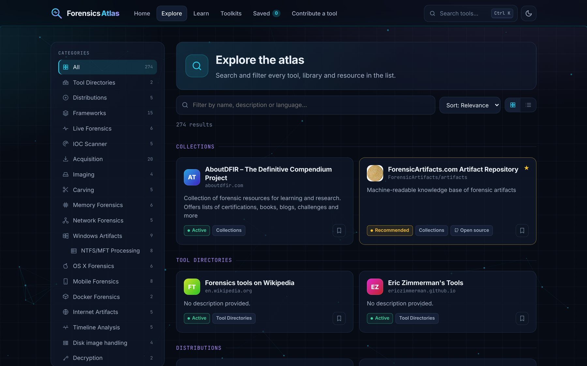

Options on this page:

| Option | What it does |
| --- | --- |
| **Category** (sidebar) | Show one category. Subcategories are indented under their parent |
| **Filter box** | Narrow results by name, description or language |
| **Maintenance status** | Any · Recommended · Active · Unmaintained · Archived |
| **Experience level** | Any · Beginner · Intermediate · Advanced |
| **Sort** | Relevance · A → Z · Status |
| **Grid / list** | Switch between cards and a compact list |
| **Save** (bookmark icon) | Add the entry to your shortlist |

Each category page opens with a banner that explains the category, its experience level, its investigation
phase and how many entries it has, plus a **Suggest a tool** button.

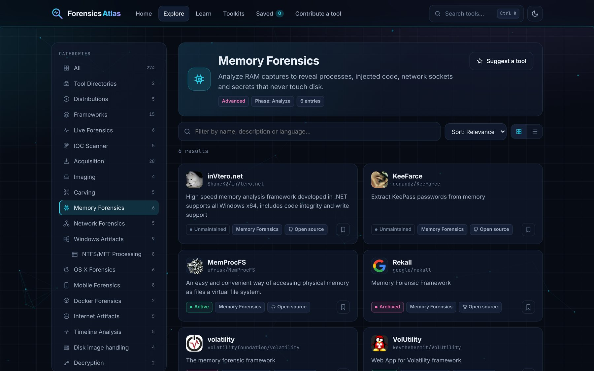

The list layout fits more entries on screen:

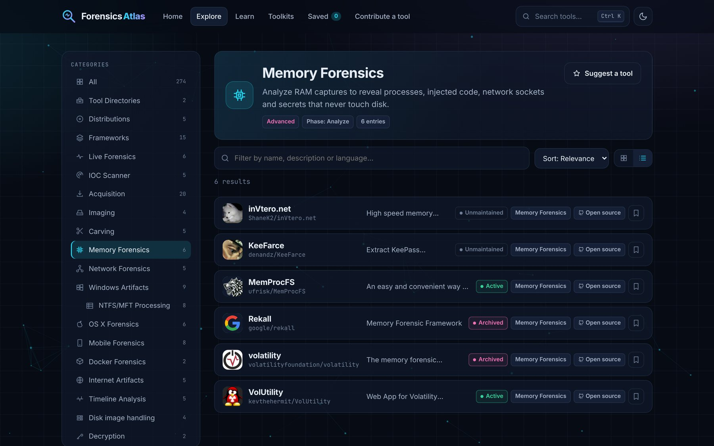

Filters combine and are kept in the address, so a filtered view can be bookmarked or shared:

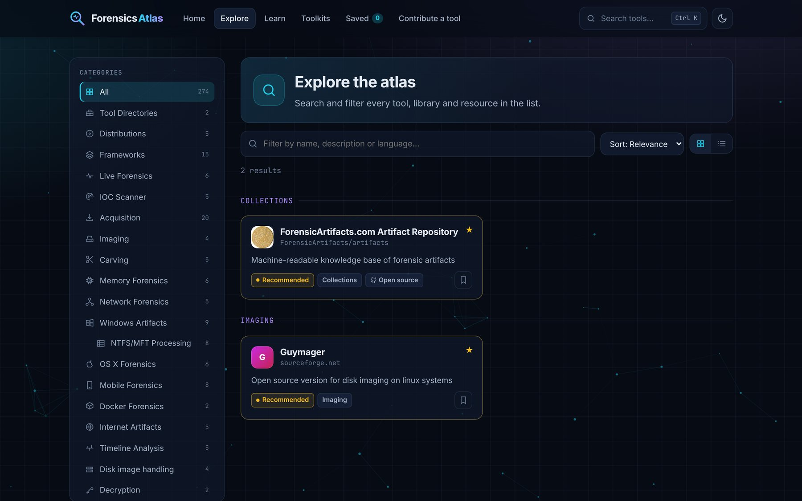

**Status badges**

| Badge | Meaning |
| --- | --- |
| Recommended | A standout tool, a good first choice |
| Active | Maintained project |
| Unmaintained | No recent activity; test carefully before relying on it |
| Archived | Kept for reference; the project is no longer developed |

## Tool details

Click any entry to open its details panel without leaving the page:

- name, description, status, experience level and investigation phase;
- website, repository and category;
- GitHub badges where available (stars, last commit, licence, top language);
- notes such as "No commits for 2+ years";
- **Visit project**, **Save** and **Copy link** (a direct link to this tool);
- **More in this category**: related tools to compare.

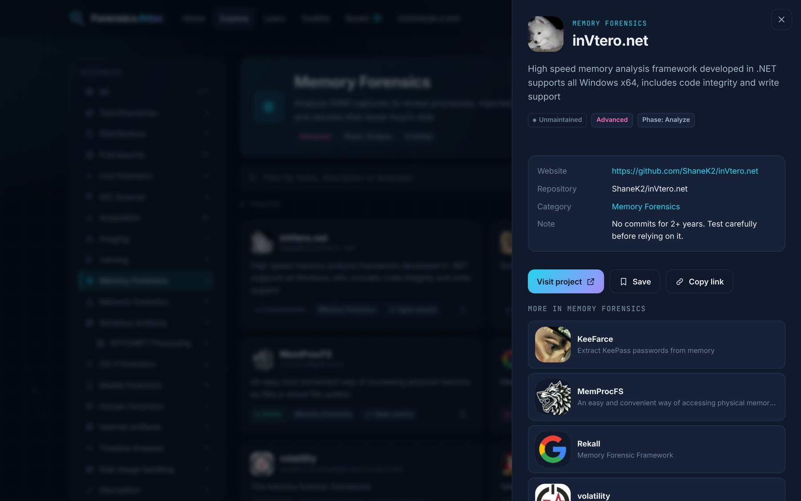

Press `Esc` or click outside the panel to close it.

## Search everything (command palette)

Press `Ctrl K` (or `⌘ K` on a Mac), or `/`, from any page. Results cover every tool and category and update as
you type. Use `↑` `↓` to move, `Enter` to open and `Esc` to close.

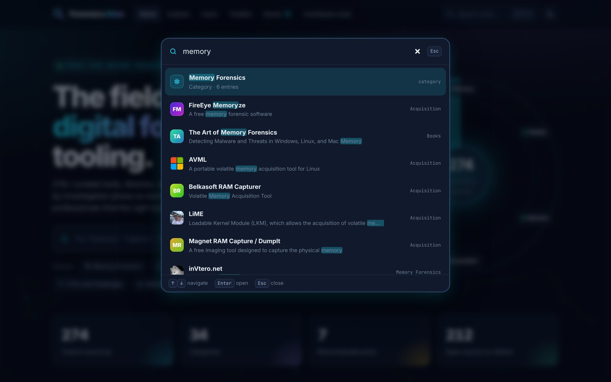

## Learning path

`#/learn` takes a newcomer from zero to investigator in five steps:

1. **Foundations**
2. **Build your lab**
3. **Core acquisition skills**
4. **Artifact analysis**
5. **Practise & prove it**

Each step links the right tools and resources, and the page also lists CTFs and challenges, books, blogs and a
glossary of common DFIR terms.

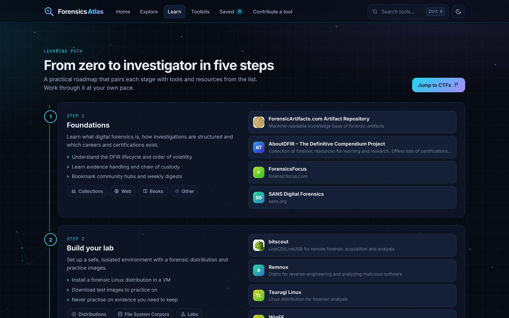

## Scenario toolkits

`#/toolkits` gives ordered tool chains for common investigations, from triage to report:

- Windows intrusion triage
- Memory-first investigation
- Disk examination
- Mobile device extraction
- Network intrusion
- macOS investigation
- Document & image authenticity
- Enterprise IR at scale

Each toolkit can be saved to your shortlist in one click.

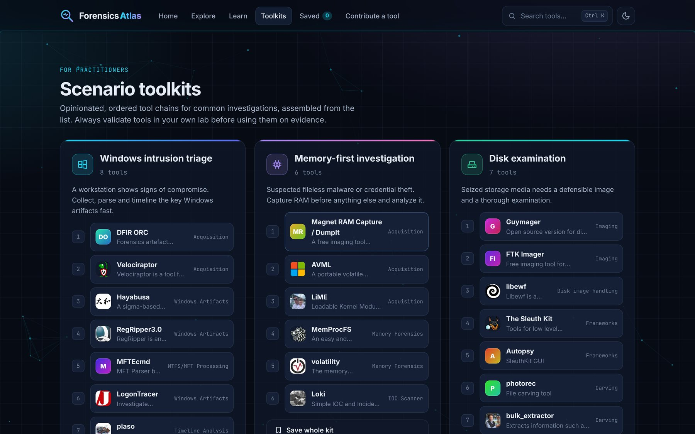

## Saved shortlist

Bookmark tools anywhere on the site and find them under **Saved** (the menu shows how many). Use it to build a
kit for a case, a course or a lab.

- **Copy as Markdown**: export the shortlist as a Markdown list to paste into notes, a report or a README.
- **Clear**: empty the list.

The shortlist is stored only in your browser; nothing is sent to a server and no account is needed.

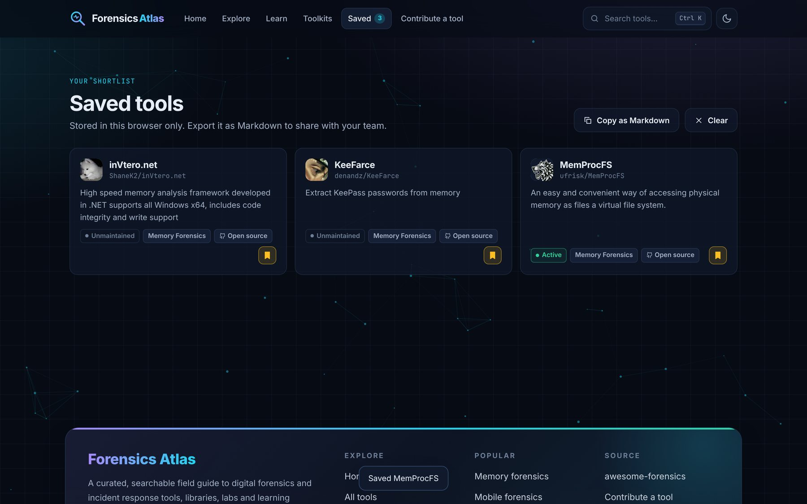

## Contribute a tool

Know a tool, library or resource that belongs in the atlas? Open **Contribute a tool** from the menu, from the
footer, from the **Suggest a tool** button on any category (the category is then pre-selected), or with a direct
link such as `#/contribute?cat=memory-forensics`.

The form matches the atlas itself:

| Field | Notes |
| --- | --- |
| Tool name, website or repository | Required. Shows a warning if the link is already listed |
| Category | Required. Grouped as in Explore, with entry counts and a short description; or **Suggest a new category** |
| Subgroup | Shown for categories that have subgroups, such as Forensic Libraries |
| What does it do? | Required. One or two sentences, as it would appear in the list |
| Project status | Active, Unmaintained or Archived |
| Language / platform | With suggestions from existing entries |
| Tags | Comma separated |
| About you | Optional name and email, used only if there is a question about the submission. Never published |
| Notes | Anything else that helps the review |

After sending you get a **reference number**. Every submission is reviewed before it is published; approved
tools appear in their category.

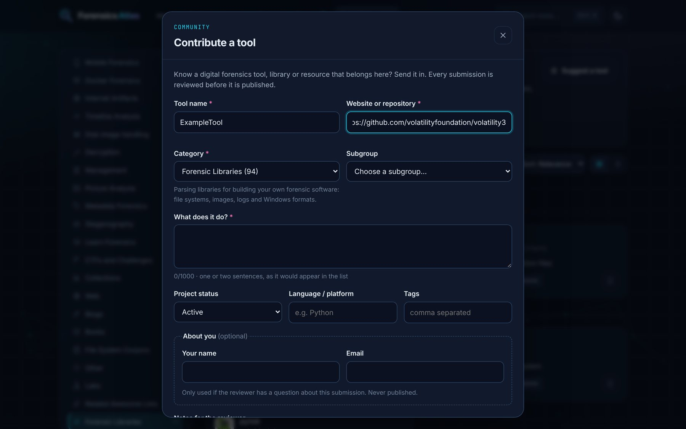

## Themes

Choose the look with the theme button in the header (it switches between the site's light and dark themes). The
site offers seven themes, all designed for readability:

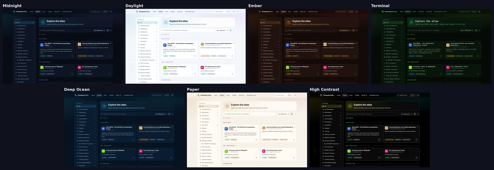

Midnight · Daylight · Ember · Terminal · Deep Ocean · Paper · High Contrast

Your choice is remembered in your browser. The site also follows your system's *reduce motion* setting.

## Phone and tablet

Every page works down to phone width: a compact menu, swipeable category chips, single-column cards, and a
full-screen Contribute form.

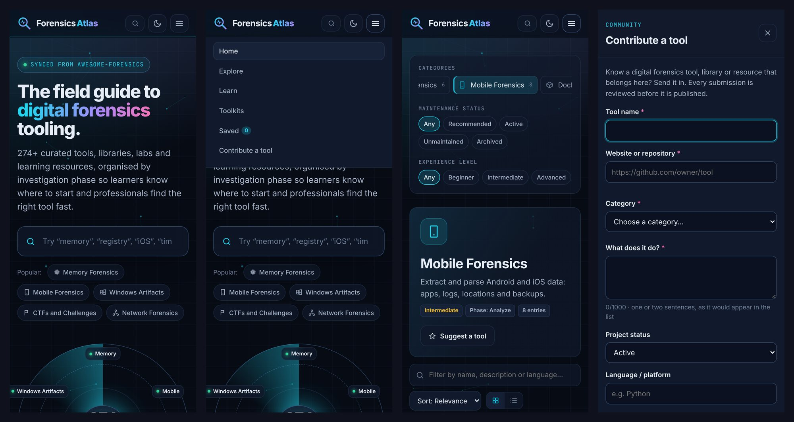

## Footer

The footer gives quick links to every page, the most popular categories, the upstream awesome-forensics list and
Contribute a tool.

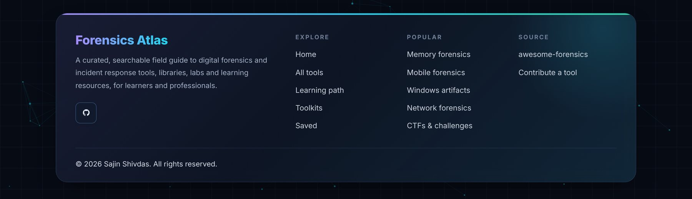

## Categories

| Group | Categories (entries) |
| --- | --- |
| **Tools** | Tool Directories (2), Distributions (5), Frameworks (15), Live Forensics (6), IOC Scanner (5), Acquisition (20), Imaging (4), Carving (5), Memory Forensics (6), Network Forensics (5), Windows Artifacts (9), NTFS/MFT Processing (8), OS X Forensics (6), Mobile Forensics (8), Docker Forensics (2), Internet Artifacts (5), Timeline Analysis (5), Disk image handling (4), Decryption (2), Management (3), Picture Analysis (2), Metadata Forensics (6), Steganography (3) |
| **Learn** | Learn Forensics (1), CTFs and Challenges (10) |
| **Resources** | Collections (2), Web (3), Blogs (5), Books (3), File System Corpora (2), Other (4), Labs (1), Related Awesome Lists (13) |
| **Develop** | Forensic Libraries (94) |

Counts reflect the list at the time of writing; the live site always shows the current numbers.

## Shareable links

Every view has its own address, so you can bookmark or share exactly what you see:

| Link | Opens |
| --- | --- |
| `/#/` | Home |
| `/#/explore` | All entries |
| `/#/explore/memory-forensics` | One category |
| `/#/explore?status=recommended&level=Beginner` | Filtered results |
| `/#/t/<tool-id>` | A tool's details panel (use **Copy link** in the panel) |
| `/#/learn` · `/#/toolkits` · `/#/saved` | Learning path, toolkits, shortlist |
| `/#/contribute` · `/#/contribute?cat=<category-id>` | Contribute a tool, optionally with a category pre-selected |

## Keyboard shortcuts

| Keys | Action |
| --- | --- |
| `Ctrl K`, `⌘ K` or `/` | Open search |
| `↑` `↓`, `Enter` | Move through and open search results |
| `Esc` | Close search, the tool panel or the Contribute form |
| `Tab` / `Shift Tab` | Move between links, filters and buttons |

## Accessibility and privacy

- Keyboard accessible throughout, with visible focus and labelled controls.
- A High Contrast theme, readable light themes and support for reduced motion.
- No account, no ads and no tracking cookies. Saved tools and your theme choice stay in your own browser.
- Project logos come from GitHub and the badges from shields.io, so your browser loads those images from them.
- Contribute a tool asks for a name and email only optionally; they are used only for questions about that
  submission and are never published.
- Served over HTTPS with strict security headers.

## FAQ

**Is it free?** Yes. There is no sign-up and nothing to install.

**How do I suggest a missing tool or report a broken link?** Use **Contribute a tool** on the site. For a
broken or outdated entry, submit it with a note explaining what changed.

**How often is the list updated?** The site follows the awesome-forensics list and approved community
submissions; new entries appear as soon as they are published.

**Where are my saved tools stored?** Only in your browser. Clearing site data or switching browsers starts a new
list, so use **Copy as Markdown** to keep a copy.

## License

Released under the [MIT License](LICENSE).

---

© Sajin Shivdas. Site: [forensics.sajinshivdas.online](https://forensics.sajinshivdas.online) ·
GitHub: [@ShivdaSaj](https://github.com/ShivdaSaj)
